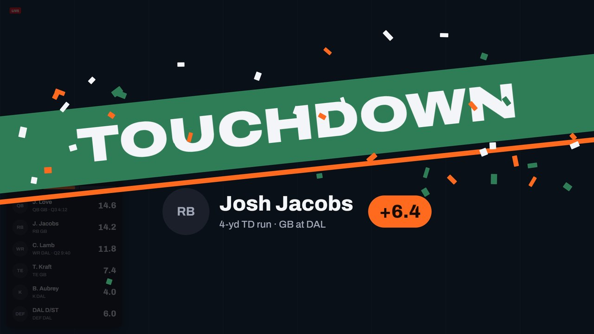
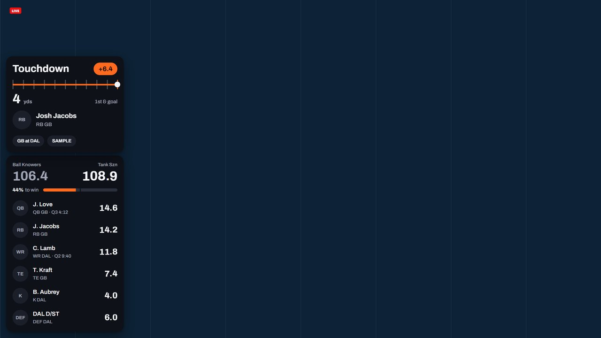
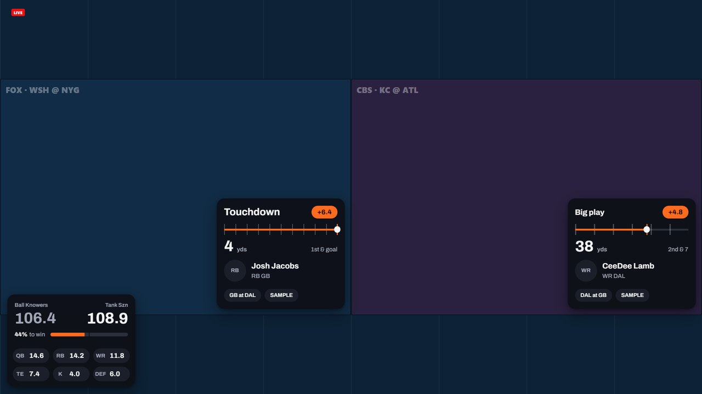

# Sideline

Your fantasy football lineup and your touchdowns, on top of the game you're watching, timed to your stream so nothing
gets spoiled. Free, no account, no server.

- **Google TV app** (Chromecast with Google TV, Google TV Streamer, NVIDIA Shield, onn, any Android TV): sits over the
  YouTube TV app, **including YouTube TV multiview**. You set it up and control it from your phone.
- **Chrome extension** (also Edge and Brave): the same box over YouTube TV and other streaming sites on a computer.



| The box and a touchdown card | Multiview: each moment lands on its own game |
| --- | --- |
|  |  |

## What you get

- **Your lineup over the game**: every starter with live points, your score against your opponent, and your chance to win.
- **Moments**: a card for each touchdown, big play, field goal and turnover by your players. **Your touchdowns take over
  the whole screen for 3 seconds** (team colours, confetti, the points), then the card follows. Your opponent's touchdowns
  and big plays get their own cards too.
- **No spoilers**: every moment waits for your stream's delay, so it shows up when the play happens on your screen, not
  before.
- **Your league's scoring**: Sleeper leagues use your league's own scoring settings (PPR, per-completion, bonuses, defense
  tiers...). ESPN leagues use ESPN's points.
- **YouTube TV multiview**: moments land on the tile showing that game, and the box moves to the corner that hides the least.

## Install on a Google TV or Android TV

You need the TV device and a phone on the same Wi-Fi.

1. **Turn on developer mode** on the TV: Settings → System → About → click **Android TV OS build** 7 times.
2. **Install Downloader** (by AFTVnews) from the Play Store on the TV.
3. **Let Downloader install apps**: Settings → Apps → Security & restrictions → Unknown sources → turn on **Downloader**.
4. **Download Sideline**: open Downloader, type this address, press Go, then **Install**:

   ```
   https://github.com/Tigertay0/sideline/releases/latest/download/sideline-tv.apk
   ```

5. **Open Sideline** on the TV, press **Allow display over other apps** and turn the switch on for Sideline. (It only
   draws its own box. It can't see or record what's on your screen.)
6. **Scan the QR code** on the TV with your phone. Your phone is now Sideline's remote:
   - add your **Sleeper username** or your **ESPN league link**,
   - under **What you watch on**, pick your app (YouTube TV, Hulu, Fubo...),
   - press **Test touchdown** to see it on the TV.
7. **Open YouTube TV** and watch. The box stays on top, comes back after a restart, and never takes the remote's focus.

**Updating**: do step 4 again. The new version installs over the old one and keeps your settings.

<details>
<summary>Install with adb instead (from a computer)</summary>

Turn on developer mode (step 1), then Settings → System → Developer options → **USB debugging** (on Google TV this also
allows debugging over the network). Find the TV's IP address under Settings → Network & Internet, then:

```bash
adb connect <tv-ip>:5555
adb install -r sideline-tv.apk
```

Accept the prompt on the TV the first time.
</details>

## Install in Chrome (or Edge, Brave)

1. Download **`sideline-chrome.zip`** from the [latest release](https://github.com/Tigertay0/sideline/releases/latest)
   and unzip it somewhere you'll keep it.
2. Open `chrome://extensions`, turn on **Developer mode** (top right), click **Load unpacked** and pick the unzipped folder.
3. Sideline's settings open. Add your **Sleeper username** and/or an **ESPN league link**. For a private ESPN league,
   sign in to espn.com in this same Chrome first: Sideline uses your own sign-in and never sees your password.
4. Open your stream: YouTube TV, Hulu, Fubo, Sling, DirecTV Stream, Peacock, Prime Video, NFL+, ESPN or Paramount+. On
   any other site, click the Sideline icon → **Show on this tab**. Click the icon → **Test TD** to see a moment.

## Getting the timing right

Streams run 30 to 60 seconds behind the real game, and every app is different. Sideline starts from a typical delay for
the app you picked. If a touchdown card shows up before the play on your screen, press **+5 s**; if it comes late, press
**−5 s**. One or two nudges during your first game is usually enough.

Sideline can't show a play sooner than about 30 seconds after it happens: that's how long ESPN's live data takes to
arrive. Streaming apps are further behind than that, so it doesn't matter in practice.

## Multiview

- **Chrome**: Sideline finds the video tiles on the page by itself.
- **TV**: YouTube TV builds the multiview picture on its servers, so no app on the TV can see the tiles. On your phone
  remote, open **Multiview**, pick the layout you see (2 side by side, 1 big + 2, or 2 × 2) and which game is in each tile
  (or **Use my live games**). Set the layout back to **Off** when you leave multiview.

## Settings

| Setting | What it does |
| --- | --- |
| Moments | Which cards you get: touchdowns, field goals, big plays, turnovers, every scoring play, your opponent's touchdowns and big plays, and whether your touchdowns fill the screen. |
| Corner, Size | Where the box sits and how big it is. |
| Show starters | Only players whose game is on, or your whole lineup. |
| Player photos | Headshots from ESPN, or initials. |
| Reduce motion | Follows your system setting: no travel, rolling numbers or confetti, only short fades. |

## Privacy

Sideline has no server and no account. Your TV or browser talks directly to ESPN's public game feeds and to Sleeper's or
ESPN's fantasy API, and nothing else. Your settings stay on the device (in Chrome they follow your Chrome profile). The
phone remote is a page served by the TV itself on your home network, and it only works with the code from the QR.

## Good to know

- **Win chance** is a rough estimate from the scores and how much of each game is left. It stays between 1% and 99% until
  every game in your matchup is over.
- **Points**: for Sleeper, Sideline works out points from ESPN's box score with your league's settings, then settles on
  Sleeper's own number for each player once it stops moving, so unusual scoring rules still end up right.
- **Private ESPN leagues** work in Chrome only. The TV can read public ESPN leagues.
- **Android draws overlay windows at most 80% opaque**, so a little of the picture shows through the box on the TV.
- **Some TVs hide "Display over other apps"**: Sideline then opens its own settings page, where the same switch is.
- **Joining mid-game** shows "syncing" for one delay length, because points already scored are newer than what you're
  watching.

## Troubleshooting

| Problem | Try this |
| --- | --- |
| Nothing shows on the TV | Open Sideline once and check the overlay switch is on, then press **Test touchdown** on the phone remote. |
| The phone can't open the remote | Phone and TV must be on the same Wi-Fi (not a guest network). Scan the QR code again. |
| Cards come too early or too late | Nudge the delay with +5 s or −5 s. |
| "That Sleeper username was not found" | Use the @name under your picture in Sleeper, not your team name. |
| Nothing shows in Chrome | Check the extension is on in `chrome://extensions`, reload the stream tab, and use **Show on this tab** on other sites. |

## Build it yourself

Everything is plain JavaScript; the TV app is a small Java app built without Gradle.

- **Chrome**: load this folder with **Load unpacked** (no build step).
- **TV app** (Windows): run `android\setup-sdk.ps1` once (installs Google's Android SDK tools; you accept Google's license
  in that window), then `android\build.ps1`. It makes `sideline-tv.apk` and, the first time, a signing key
  (`android/debug.keystore`, never committed). Set `SIDELINE_KEYSTORE_PASS` to use your own password.

```bash
npm test                     # scoring, the delay ledger, league sources, multiview logic
python -m http.server 8137   # then open demo/animations.html, demo/scene.html?scene=td or demo/multiview.html
node tv/dev-server.js        # the TV pages in a browser: http://127.0.0.1:8138/tv/home.html?k=TEST42
```

`demo/` and `tv/dev-server.js` run the real code against a scripted game, so you can work on the box, the delay and
multiview with no account and no live game.

## License

MIT, see [LICENSE](LICENSE). The Archivo font is under the SIL Open Font License ([src/ui/fonts/OFL.txt](src/ui/fonts/OFL.txt)).
The QR code generator in `tv/qrcode.js` is by Kazuhiko Arase, MIT.

Sideline is an independent project. It isn't affiliated with or endorsed by the NFL, ESPN, Sleeper, YouTube or Google.
Team names, player photos and game data belong to their owners and are loaded live from their public services.
